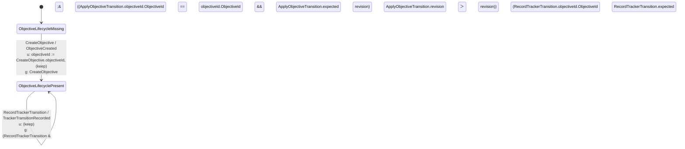
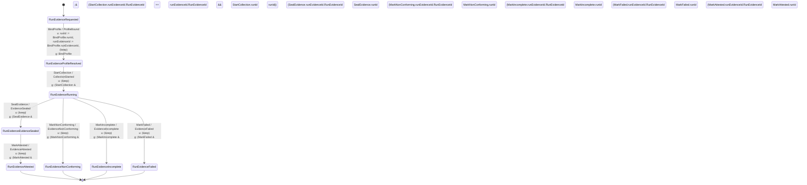
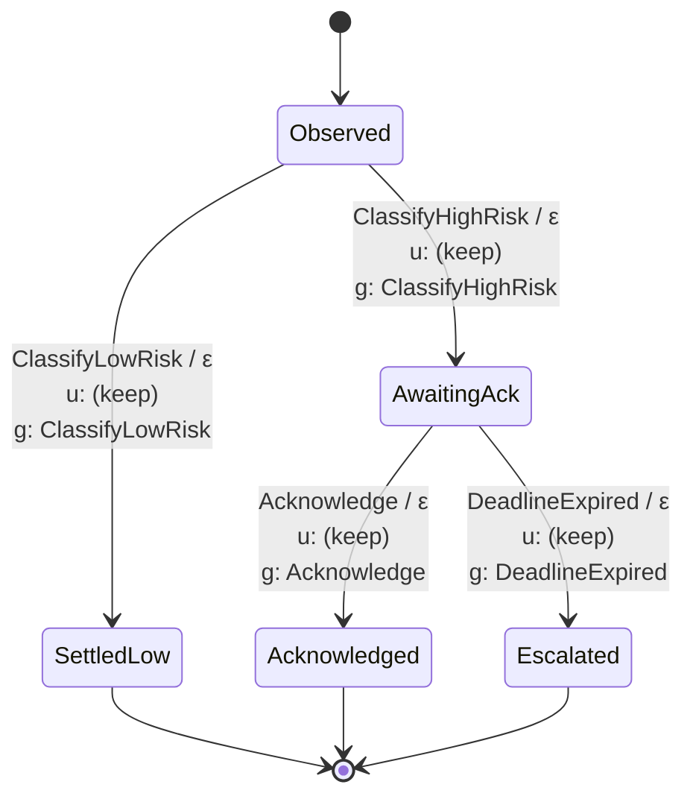

<!-- Generated by just domain-diagrams; edit executable transducers. -->

Four persisted aggregates and the diagram-only at-risk flow. The latter uses the workflow journal for durable state.

## Execution lifecycle

```mermaid
stateDiagram-v2
    [*] --> ExecutionLifecycleMissing
    ExecutionLifecycleMissing --> ExecutionLifecycleActive : AdmitExecution / ExecutionAdmitted<br/>u: snapshotDigest := AdmitExecution.snapshotDigest, executionId := AdmitExecution.executionId, (keep)<br/>g: AdmitExecution
    ExecutionLifecycleActive --> ExecutionLifecycleActive : AdvanceExecution / ExecutionAdvanced<br/>u: revision := AdvanceExecution.revision, (keep)<br/>g: (AdvanceExecution &amp;&amp; ((AdvanceExecution.executionId.ExecutionIdentity == executionId.ExecutionIdentity &amp;&amp; AdvanceExecution.expected == revision) &amp;&amp; AdvanceExecution.revision ＞ revision))
    ExecutionLifecycleActive --> ExecutionLifecycleParked : ParkExecution / ExecutionParked<br/>u: revision := ParkExecution.revision, (keep)<br/>g: (ParkExecution &amp;&amp; ((ParkExecution.executionId.ExecutionIdentity == executionId.ExecutionIdentity &amp;&amp; ParkExecution.expected == revision) &amp;&amp; ParkExecution.revision ＞ revision))
    ExecutionLifecycleActive --> ExecutionLifecycleUnresolved : MarkExecutionUnresolved / ExecutionBecameUnresolved<br/>u: revision := MarkExecutionUnresolved.revision, (keep)<br/>g: (MarkExecutionUnresolved &amp;&amp; ((MarkExecutionUnresolved.executionId.ExecutionIdentity == executionId.ExecutionIdentity &amp;&amp; MarkExecutionUnresolved.expected == revision) &amp;&amp; MarkExecutionUnresolved.revision ＞ revision))
    ExecutionLifecycleActive --> ExecutionLifecycleSucceeded : FinishExecution / ExecutionFinished<br/>u: revision := FinishExecution.revision, (keep)<br/>g: (FinishExecution &amp;&amp; ((FinishExecution.executionId.ExecutionIdentity == executionId.ExecutionIdentity &amp;&amp; FinishExecution.expected == revision) &amp;&amp; FinishExecution.revision ＞ revision))
    ExecutionLifecycleActive --> ExecutionLifecycleFailed : FailExecution / ExecutionFailed<br/>u: revision := FailExecution.revision, (keep)<br/>g: (FailExecution &amp;&amp; ((FailExecution.executionId.ExecutionIdentity == executionId.ExecutionIdentity &amp;&amp; FailExecution.expected == revision) &amp;&amp; FailExecution.revision ＞ revision))
    ExecutionLifecycleActive --> ExecutionLifecycleCancelled : CancelExecution / ExecutionCancelled<br/>u: revision := CancelExecution.revision, (keep)<br/>g: (CancelExecution &amp;&amp; ((CancelExecution.executionId.ExecutionIdentity == executionId.ExecutionIdentity &amp;&amp; CancelExecution.expected == revision) &amp;&amp; CancelExecution.revision ＞ revision))
    ExecutionLifecycleActive --> ExecutionLifecycleActive : SettleExecutionReceipt / ExecutionReceiptSettled<br/>u: pendingReceipts := SettleExecutionReceipt.remaining, revision := SettleExecutionReceipt.revision, (keep)<br/>g: (SettleExecutionReceipt &amp;&amp; ((((SettleExecutionReceipt.executionId.ExecutionIdentity == executionId.ExecutionIdentity &amp;&amp; SettleExecutionReceipt.expected == revision) &amp;&amp; SettleExecutionReceipt.revision ＞ revision) &amp;&amp; pendingReceipts ＞ 0) &amp;&amp; SettleExecutionReceipt.remaining == (pendingReceipts - 1)))
    ExecutionLifecycleActive --> ExecutionLifecycleSucceededPendingReceipts : FinishExecutionPendingReceipts / ExecutionFinishedPendingReceipts<br/>u: revision := FinishExecutionPendingReceipts.revision, (keep)<br/>g: (FinishExecutionPendingReceipts &amp;&amp; (((FinishExecutionPendingReceipts.executionId.ExecutionIdentity == executionId.ExecutionIdentity &amp;&amp; FinishExecutionPendingReceipts.expected == revision) &amp;&amp; FinishExecutionPendingReceipts.revision ＞ revision) &amp;&amp; pendingReceipts ＞ 0))
    ExecutionLifecycleActive --> ExecutionLifecycleFailedPendingReceipts : FailExecutionPendingReceipts / ExecutionFailedPendingReceipts<br/>u: revision := FailExecutionPendingReceipts.revision, (keep)<br/>g: (FailExecutionPendingReceipts &amp;&amp; (((FailExecutionPendingReceipts.executionId.ExecutionIdentity == executionId.ExecutionIdentity &amp;&amp; FailExecutionPendingReceipts.expected == revision) &amp;&amp; FailExecutionPendingReceipts.revision ＞ revision) &amp;&amp; pendingReceipts ＞ 0))
    ExecutionLifecycleActive --> ExecutionLifecycleCancelledPendingReceipts : CancelExecutionPendingReceipts / ExecutionCancelledPendingReceipts<br/>u: revision := CancelExecutionPendingReceipts.revision, (keep)<br/>g: (CancelExecutionPendingReceipts &amp;&amp; (((CancelExecutionPendingReceipts.executionId.ExecutionIdentity == executionId.ExecutionIdentity &amp;&amp; CancelExecutionPendingReceipts.expected == revision) &amp;&amp; CancelExecutionPendingReceipts.revision ＞ revision) &amp;&amp; pendingReceipts ＞ 0))
    ExecutionLifecycleParked --> ExecutionLifecycleActive : ResumeExecution / ExecutionResumed<br/>u: revision := ResumeExecution.revision, (keep)<br/>g: (ResumeExecution &amp;&amp; ((ResumeExecution.executionId.ExecutionIdentity == executionId.ExecutionIdentity &amp;&amp; ResumeExecution.expected == revision) &amp;&amp; ResumeExecution.revision ＞ revision))
    ExecutionLifecycleParked --> ExecutionLifecycleFailed : FailExecution / ExecutionFailed<br/>u: revision := FailExecution.revision, (keep)<br/>g: (FailExecution &amp;&amp; ((FailExecution.executionId.ExecutionIdentity == executionId.ExecutionIdentity &amp;&amp; FailExecution.expected == revision) &amp;&amp; FailExecution.revision ＞ revision))
    ExecutionLifecycleParked --> ExecutionLifecycleCancelled : CancelExecution / ExecutionCancelled<br/>u: revision := CancelExecution.revision, (keep)<br/>g: (CancelExecution &amp;&amp; ((CancelExecution.executionId.ExecutionIdentity == executionId.ExecutionIdentity &amp;&amp; CancelExecution.expected == revision) &amp;&amp; CancelExecution.revision ＞ revision))
    ExecutionLifecycleParked --> ExecutionLifecycleParked : SettleExecutionReceipt / ExecutionReceiptSettled<br/>u: pendingReceipts := SettleExecutionReceipt.remaining, revision := SettleExecutionReceipt.revision, (keep)<br/>g: (SettleExecutionReceipt &amp;&amp; ((((SettleExecutionReceipt.executionId.ExecutionIdentity == executionId.ExecutionIdentity &amp;&amp; SettleExecutionReceipt.expected == revision) &amp;&amp; SettleExecutionReceipt.revision ＞ revision) &amp;&amp; pendingReceipts ＞ 0) &amp;&amp; SettleExecutionReceipt.remaining == (pendingReceipts - 1)))
    ExecutionLifecycleParked --> ExecutionLifecycleFailedPendingReceipts : FailExecutionPendingReceipts / ExecutionFailedPendingReceipts<br/>u: revision := FailExecutionPendingReceipts.revision, (keep)<br/>g: (FailExecutionPendingReceipts &amp;&amp; (((FailExecutionPendingReceipts.executionId.ExecutionIdentity == executionId.ExecutionIdentity &amp;&amp; FailExecutionPendingReceipts.expected == revision) &amp;&amp; FailExecutionPendingReceipts.revision ＞ revision) &amp;&amp; pendingReceipts ＞ 0))
    ExecutionLifecycleParked --> ExecutionLifecycleCancelledPendingReceipts : CancelExecutionPendingReceipts / ExecutionCancelledPendingReceipts<br/>u: revision := CancelExecutionPendingReceipts.revision, (keep)<br/>g: (CancelExecutionPendingReceipts &amp;&amp; (((CancelExecutionPendingReceipts.executionId.ExecutionIdentity == executionId.ExecutionIdentity &amp;&amp; CancelExecutionPendingReceipts.expected == revision) &amp;&amp; CancelExecutionPendingReceipts.revision ＞ revision) &amp;&amp; pendingReceipts ＞ 0))
    ExecutionLifecycleUnresolved --> ExecutionLifecycleUnresolved : MarkExecutionUnresolved / ExecutionBecameUnresolved<br/>u: revision := MarkExecutionUnresolved.revision, (keep)<br/>g: (MarkExecutionUnresolved &amp;&amp; ((MarkExecutionUnresolved.executionId.ExecutionIdentity == executionId.ExecutionIdentity &amp;&amp; MarkExecutionUnresolved.expected == revision) &amp;&amp; MarkExecutionUnresolved.revision ＞ revision))
    ExecutionLifecycleUnresolved --> ExecutionLifecycleActive : ReconcileExecution / ExecutionReconciled<br/>u: revision := ReconcileExecution.revision, (keep)<br/>g: (ReconcileExecution &amp;&amp; ((ReconcileExecution.executionId.ExecutionIdentity == executionId.ExecutionIdentity &amp;&amp; ReconcileExecution.expected == revision) &amp;&amp; ReconcileExecution.revision ＞ revision))
    ExecutionLifecycleUnresolved --> ExecutionLifecycleFailed : FailExecution / ExecutionFailed<br/>u: revision := FailExecution.revision, (keep)<br/>g: (FailExecution &amp;&amp; ((FailExecution.executionId.ExecutionIdentity == executionId.ExecutionIdentity &amp;&amp; FailExecution.expected == revision) &amp;&amp; FailExecution.revision ＞ revision))
    ExecutionLifecycleUnresolved --> ExecutionLifecycleCancelled : CancelExecution / ExecutionCancelled<br/>u: revision := CancelExecution.revision, (keep)<br/>g: (CancelExecution &amp;&amp; ((CancelExecution.executionId.ExecutionIdentity == executionId.ExecutionIdentity &amp;&amp; CancelExecution.expected == revision) &amp;&amp; CancelExecution.revision ＞ revision))
    ExecutionLifecycleUnresolved --> ExecutionLifecycleActive : RetryExecution / ExecutionRetried<br/>u: pendingReceipts := (pendingReceipts + 1), revision := RetryExecution.revision, (keep)<br/>g: (RetryExecution &amp;&amp; ((RetryExecution.executionId.ExecutionIdentity == executionId.ExecutionIdentity &amp;&amp; RetryExecution.expected == revision) &amp;&amp; RetryExecution.revision ＞ revision))
    ExecutionLifecycleUnresolved --> ExecutionLifecycleUnresolved : SettleExecutionReceipt / ExecutionReceiptSettled<br/>u: pendingReceipts := SettleExecutionReceipt.remaining, revision := SettleExecutionReceipt.revision, (keep)<br/>g: (SettleExecutionReceipt &amp;&amp; ((((SettleExecutionReceipt.executionId.ExecutionIdentity == executionId.ExecutionIdentity &amp;&amp; SettleExecutionReceipt.expected == revision) &amp;&amp; SettleExecutionReceipt.revision ＞ revision) &amp;&amp; pendingReceipts ＞ 0) &amp;&amp; SettleExecutionReceipt.remaining == (pendingReceipts - 1)))
    ExecutionLifecycleUnresolved --> ExecutionLifecycleFailedPendingReceipts : FailExecutionPendingReceipts / ExecutionFailedPendingReceipts<br/>u: revision := FailExecutionPendingReceipts.revision, (keep)<br/>g: (FailExecutionPendingReceipts &amp;&amp; (((FailExecutionPendingReceipts.executionId.ExecutionIdentity == executionId.ExecutionIdentity &amp;&amp; FailExecutionPendingReceipts.expected == revision) &amp;&amp; FailExecutionPendingReceipts.revision ＞ revision) &amp;&amp; pendingReceipts ＞ 0))
    ExecutionLifecycleUnresolved --> ExecutionLifecycleCancelledPendingReceipts : CancelExecutionPendingReceipts / ExecutionCancelledPendingReceipts<br/>u: revision := CancelExecutionPendingReceipts.revision, (keep)<br/>g: (CancelExecutionPendingReceipts &amp;&amp; (((CancelExecutionPendingReceipts.executionId.ExecutionIdentity == executionId.ExecutionIdentity &amp;&amp; CancelExecutionPendingReceipts.expected == revision) &amp;&amp; CancelExecutionPendingReceipts.revision ＞ revision) &amp;&amp; pendingReceipts ＞ 0))
    ExecutionLifecycleSucceededPendingReceipts --> ExecutionLifecycleSucceededPendingReceipts : SettleExecutionReceipt / ExecutionReceiptSettled<br/>u: pendingReceipts := SettleExecutionReceipt.remaining, revision := SettleExecutionReceipt.revision, (keep)<br/>g: (SettleExecutionReceipt &amp;&amp; (((((SettleExecutionReceipt.executionId.ExecutionIdentity == executionId.ExecutionIdentity &amp;&amp; SettleExecutionReceipt.expected == revision) &amp;&amp; SettleExecutionReceipt.revision ＞ revision) &amp;&amp; pendingReceipts ＞ 0) &amp;&amp; SettleExecutionReceipt.remaining == (pendingReceipts - 1)) &amp;&amp; SettleExecutionReceipt.remaining ＞ 0))
    ExecutionLifecycleSucceededPendingReceipts --> ExecutionLifecycleSucceeded : SettleExecutionReceipt / ExecutionReceiptsClosed<br/>u: pendingReceipts := SettleExecutionReceipt.remaining, revision := SettleExecutionReceipt.revision, (keep)<br/>g: (SettleExecutionReceipt &amp;&amp; (((((SettleExecutionReceipt.executionId.ExecutionIdentity == executionId.ExecutionIdentity &amp;&amp; SettleExecutionReceipt.expected == revision) &amp;&amp; SettleExecutionReceipt.revision ＞ revision) &amp;&amp; pendingReceipts ＞ 0) &amp;&amp; SettleExecutionReceipt.remaining == (pendingReceipts - 1)) &amp;&amp; SettleExecutionReceipt.remaining == 0))
    ExecutionLifecycleFailedPendingReceipts --> ExecutionLifecycleFailedPendingReceipts : SettleExecutionReceipt / ExecutionReceiptSettled<br/>u: pendingReceipts := SettleExecutionReceipt.remaining, revision := SettleExecutionReceipt.revision, (keep)<br/>g: (SettleExecutionReceipt &amp;&amp; (((((SettleExecutionReceipt.executionId.ExecutionIdentity == executionId.ExecutionIdentity &amp;&amp; SettleExecutionReceipt.expected == revision) &amp;&amp; SettleExecutionReceipt.revision ＞ revision) &amp;&amp; pendingReceipts ＞ 0) &amp;&amp; SettleExecutionReceipt.remaining == (pendingReceipts - 1)) &amp;&amp; SettleExecutionReceipt.remaining ＞ 0))
    ExecutionLifecycleFailedPendingReceipts --> ExecutionLifecycleFailed : SettleExecutionReceipt / ExecutionReceiptsClosed<br/>u: pendingReceipts := SettleExecutionReceipt.remaining, revision := SettleExecutionReceipt.revision, (keep)<br/>g: (SettleExecutionReceipt &amp;&amp; (((((SettleExecutionReceipt.executionId.ExecutionIdentity == executionId.ExecutionIdentity &amp;&amp; SettleExecutionReceipt.expected == revision) &amp;&amp; SettleExecutionReceipt.revision ＞ revision) &amp;&amp; pendingReceipts ＞ 0) &amp;&amp; SettleExecutionReceipt.remaining == (pendingReceipts - 1)) &amp;&amp; SettleExecutionReceipt.remaining == 0))
    ExecutionLifecycleCancelledPendingReceipts --> ExecutionLifecycleCancelledPendingReceipts : SettleExecutionReceipt / ExecutionReceiptSettled<br/>u: pendingReceipts := SettleExecutionReceipt.remaining, revision := SettleExecutionReceipt.revision, (keep)<br/>g: (SettleExecutionReceipt &amp;&amp; (((((SettleExecutionReceipt.executionId.ExecutionIdentity == executionId.ExecutionIdentity &amp;&amp; SettleExecutionReceipt.expected == revision) &amp;&amp; SettleExecutionReceipt.revision ＞ revision) &amp;&amp; pendingReceipts ＞ 0) &amp;&amp; SettleExecutionReceipt.remaining == (pendingReceipts - 1)) &amp;&amp; SettleExecutionReceipt.remaining ＞ 0))
    ExecutionLifecycleCancelledPendingReceipts --> ExecutionLifecycleCancelled : SettleExecutionReceipt / ExecutionReceiptsClosed<br/>u: pendingReceipts := SettleExecutionReceipt.remaining, revision := SettleExecutionReceipt.revision, (keep)<br/>g: (SettleExecutionReceipt &amp;&amp; (((((SettleExecutionReceipt.executionId.ExecutionIdentity == executionId.ExecutionIdentity &amp;&amp; SettleExecutionReceipt.expected == revision) &amp;&amp; SettleExecutionReceipt.revision ＞ revision) &amp;&amp; pendingReceipts ＞ 0) &amp;&amp; SettleExecutionReceipt.remaining == (pendingReceipts - 1)) &amp;&amp; SettleExecutionReceipt.remaining == 0))
    ExecutionLifecycleSucceeded --> [*]
    ExecutionLifecycleFailed --> [*]
    ExecutionLifecycleCancelled --> [*]
```

## Worker session lifecycle

```mermaid
stateDiagram-v2
    [*] --> WorkerSessionLifecycleMissing
    WorkerSessionLifecycleMissing --> WorkerSessionLifecycleIdle : AdmitWorkerSession / WorkerSessionAdmitted<br/>u: bindingDigest := AdmitWorkerSession.bindingDigest, sessionId := AdmitWorkerSession.sessionId, (keep)<br/>g: AdmitWorkerSession
    WorkerSessionLifecycleIdle --> WorkerSessionLifecycleIdle : AcceptSessionMessage / SessionMessageAccepted<br/>u: revision := AcceptSessionMessage.revision, (keep)<br/>g: (AcceptSessionMessage &amp;&amp; ((AcceptSessionMessage.sessionId.WorkerSessionIdentity == sessionId.WorkerSessionIdentity &amp;&amp; AcceptSessionMessage.expected == revision) &amp;&amp; AcceptSessionMessage.revision ＞ revision))
    WorkerSessionLifecycleIdle --> WorkerSessionLifecycleIdle : ConsumeSessionEvents / SessionEventsConsumed<br/>u: revision := ConsumeSessionEvents.revision, (keep)<br/>g: (ConsumeSessionEvents &amp;&amp; ((ConsumeSessionEvents.sessionId.WorkerSessionIdentity == sessionId.WorkerSessionIdentity &amp;&amp; ConsumeSessionEvents.expected == revision) &amp;&amp; ConsumeSessionEvents.revision ＞ revision))
    WorkerSessionLifecycleIdle --> WorkerSessionLifecycleIdle : PrepareSessionCheckpoint / SessionCheckpointPrepared<br/>u: revision := PrepareSessionCheckpoint.revision, (keep)<br/>g: (PrepareSessionCheckpoint &amp;&amp; ((PrepareSessionCheckpoint.sessionId.WorkerSessionIdentity == sessionId.WorkerSessionIdentity &amp;&amp; PrepareSessionCheckpoint.expected == revision) &amp;&amp; PrepareSessionCheckpoint.revision ＞ revision))
    WorkerSessionLifecycleIdle --> WorkerSessionLifecycleIdle : ObserveWorkerSession / WorkerSessionObserved<br/>u: revision := ObserveWorkerSession.revision, (keep)<br/>g: (ObserveWorkerSession &amp;&amp; ((ObserveWorkerSession.sessionId.WorkerSessionIdentity == sessionId.WorkerSessionIdentity &amp;&amp; ObserveWorkerSession.expected == revision) &amp;&amp; ObserveWorkerSession.revision ＞ revision))
    WorkerSessionLifecycleIdle --> WorkerSessionLifecycleActive : StartSessionAssignment / SessionAssignmentStarted<br/>u: revision := StartSessionAssignment.revision, (keep)<br/>g: (StartSessionAssignment &amp;&amp; ((StartSessionAssignment.sessionId.WorkerSessionIdentity == sessionId.WorkerSessionIdentity &amp;&amp; StartSessionAssignment.expected == revision) &amp;&amp; StartSessionAssignment.revision ＞ revision))
    WorkerSessionLifecycleIdle --> WorkerSessionLifecycleFailed : FailWorkerSession / WorkerSessionFailed<br/>u: revision := FailWorkerSession.revision, (keep)<br/>g: (FailWorkerSession &amp;&amp; ((FailWorkerSession.sessionId.WorkerSessionIdentity == sessionId.WorkerSessionIdentity &amp;&amp; FailWorkerSession.expected == revision) &amp;&amp; FailWorkerSession.revision ＞ revision))
    WorkerSessionLifecycleIdle --> WorkerSessionLifecycleCancelled : CancelWorkerSession / WorkerSessionCancelled<br/>u: revision := CancelWorkerSession.revision, (keep)<br/>g: (CancelWorkerSession &amp;&amp; ((CancelWorkerSession.sessionId.WorkerSessionIdentity == sessionId.WorkerSessionIdentity &amp;&amp; CancelWorkerSession.expected == revision) &amp;&amp; CancelWorkerSession.revision ＞ revision))
    WorkerSessionLifecycleIdle --> WorkerSessionLifecycleTransferring : RequestSessionTransfer / SessionTransferRequested<br/>u: revision := RequestSessionTransfer.revision, (keep)<br/>g: (RequestSessionTransfer &amp;&amp; ((RequestSessionTransfer.sessionId.WorkerSessionIdentity == sessionId.WorkerSessionIdentity &amp;&amp; RequestSessionTransfer.expected == revision) &amp;&amp; RequestSessionTransfer.revision ＞ revision))
    WorkerSessionLifecycleIdle --> WorkerSessionLifecycleIdle : SubscribeSessionEvents / SessionEventsSubscribed<br/>u: revision := SubscribeSessionEvents.revision, (keep)<br/>g: (SubscribeSessionEvents &amp;&amp; ((SubscribeSessionEvents.sessionId.WorkerSessionIdentity == sessionId.WorkerSessionIdentity &amp;&amp; SubscribeSessionEvents.expected == revision) &amp;&amp; SubscribeSessionEvents.revision ＞ revision))
    WorkerSessionLifecycleIdle --> WorkerSessionLifecycleIdle : SupersedeSessionCheckpoint / SessionCheckpointSuperseded<br/>u: revision := SupersedeSessionCheckpoint.revision, (keep)<br/>g: (SupersedeSessionCheckpoint &amp;&amp; ((SupersedeSessionCheckpoint.sessionId.WorkerSessionIdentity == sessionId.WorkerSessionIdentity &amp;&amp; SupersedeSessionCheckpoint.expected == revision) &amp;&amp; SupersedeSessionCheckpoint.revision ＞ revision))
    WorkerSessionLifecycleActive --> WorkerSessionLifecycleActive : AcceptSessionMessage / SessionMessageAccepted<br/>u: revision := AcceptSessionMessage.revision, (keep)<br/>g: (AcceptSessionMessage &amp;&amp; ((AcceptSessionMessage.sessionId.WorkerSessionIdentity == sessionId.WorkerSessionIdentity &amp;&amp; AcceptSessionMessage.expected == revision) &amp;&amp; AcceptSessionMessage.revision ＞ revision))
    WorkerSessionLifecycleActive --> WorkerSessionLifecycleActive : ConsumeSessionEvents / SessionEventsConsumed<br/>u: revision := ConsumeSessionEvents.revision, (keep)<br/>g: (ConsumeSessionEvents &amp;&amp; ((ConsumeSessionEvents.sessionId.WorkerSessionIdentity == sessionId.WorkerSessionIdentity &amp;&amp; ConsumeSessionEvents.expected == revision) &amp;&amp; ConsumeSessionEvents.revision ＞ revision))
    WorkerSessionLifecycleActive --> WorkerSessionLifecycleActive : PrepareSessionCheckpoint / SessionCheckpointPrepared<br/>u: revision := PrepareSessionCheckpoint.revision, (keep)<br/>g: (PrepareSessionCheckpoint &amp;&amp; ((PrepareSessionCheckpoint.sessionId.WorkerSessionIdentity == sessionId.WorkerSessionIdentity &amp;&amp; PrepareSessionCheckpoint.expected == revision) &amp;&amp; PrepareSessionCheckpoint.revision ＞ revision))
    WorkerSessionLifecycleActive --> WorkerSessionLifecycleActive : ObserveWorkerSession / WorkerSessionObserved<br/>u: revision := ObserveWorkerSession.revision, (keep)<br/>g: (ObserveWorkerSession &amp;&amp; ((ObserveWorkerSession.sessionId.WorkerSessionIdentity == sessionId.WorkerSessionIdentity &amp;&amp; ObserveWorkerSession.expected == revision) &amp;&amp; ObserveWorkerSession.revision ＞ revision))
    WorkerSessionLifecycleActive --> WorkerSessionLifecycleParked : ParkSessionAssignment / SessionAssignmentParked<br/>u: revision := ParkSessionAssignment.revision, (keep)<br/>g: (ParkSessionAssignment &amp;&amp; ((ParkSessionAssignment.sessionId.WorkerSessionIdentity == sessionId.WorkerSessionIdentity &amp;&amp; ParkSessionAssignment.expected == revision) &amp;&amp; ParkSessionAssignment.revision ＞ revision))
    WorkerSessionLifecycleActive --> WorkerSessionLifecycleIdle : RecordSessionResult / SessionResultRecorded<br/>u: revision := RecordSessionResult.revision, (keep)<br/>g: (RecordSessionResult &amp;&amp; ((RecordSessionResult.sessionId.WorkerSessionIdentity == sessionId.WorkerSessionIdentity &amp;&amp; RecordSessionResult.expected == revision) &amp;&amp; RecordSessionResult.revision ＞ revision))
    WorkerSessionLifecycleActive --> WorkerSessionLifecycleUnresolved : MarkSessionUnresolved / SessionBecameUnresolved<br/>u: revision := MarkSessionUnresolved.revision, (keep)<br/>g: (MarkSessionUnresolved &amp;&amp; ((MarkSessionUnresolved.sessionId.WorkerSessionIdentity == sessionId.WorkerSessionIdentity &amp;&amp; MarkSessionUnresolved.expected == revision) &amp;&amp; MarkSessionUnresolved.revision ＞ revision))
    WorkerSessionLifecycleActive --> WorkerSessionLifecycleTransferring : RequestSessionTransfer / SessionTransferRequested<br/>u: revision := RequestSessionTransfer.revision, (keep)<br/>g: (RequestSessionTransfer &amp;&amp; ((RequestSessionTransfer.sessionId.WorkerSessionIdentity == sessionId.WorkerSessionIdentity &amp;&amp; RequestSessionTransfer.expected == revision) &amp;&amp; RequestSessionTransfer.revision ＞ revision))
    WorkerSessionLifecycleActive --> WorkerSessionLifecycleActive : SubscribeSessionEvents / SessionEventsSubscribed<br/>u: revision := SubscribeSessionEvents.revision, (keep)<br/>g: (SubscribeSessionEvents &amp;&amp; ((SubscribeSessionEvents.sessionId.WorkerSessionIdentity == sessionId.WorkerSessionIdentity &amp;&amp; SubscribeSessionEvents.expected == revision) &amp;&amp; SubscribeSessionEvents.revision ＞ revision))
    WorkerSessionLifecycleActive --> WorkerSessionLifecycleActive : SupersedeSessionCheckpoint / SessionCheckpointSuperseded<br/>u: revision := SupersedeSessionCheckpoint.revision, (keep)<br/>g: (SupersedeSessionCheckpoint &amp;&amp; ((SupersedeSessionCheckpoint.sessionId.WorkerSessionIdentity == sessionId.WorkerSessionIdentity &amp;&amp; SupersedeSessionCheckpoint.expected == revision) &amp;&amp; SupersedeSessionCheckpoint.revision ＞ revision))
    WorkerSessionLifecycleParked --> WorkerSessionLifecycleParked : AcceptSessionMessage / SessionMessageAccepted<br/>u: revision := AcceptSessionMessage.revision, (keep)<br/>g: (AcceptSessionMessage &amp;&amp; ((AcceptSessionMessage.sessionId.WorkerSessionIdentity == sessionId.WorkerSessionIdentity &amp;&amp; AcceptSessionMessage.expected == revision) &amp;&amp; AcceptSessionMessage.revision ＞ revision))
    WorkerSessionLifecycleParked --> WorkerSessionLifecycleParked : ConsumeSessionEvents / SessionEventsConsumed<br/>u: revision := ConsumeSessionEvents.revision, (keep)<br/>g: (ConsumeSessionEvents &amp;&amp; ((ConsumeSessionEvents.sessionId.WorkerSessionIdentity == sessionId.WorkerSessionIdentity &amp;&amp; ConsumeSessionEvents.expected == revision) &amp;&amp; ConsumeSessionEvents.revision ＞ revision))
    WorkerSessionLifecycleParked --> WorkerSessionLifecycleParked : PrepareSessionCheckpoint / SessionCheckpointPrepared<br/>u: revision := PrepareSessionCheckpoint.revision, (keep)<br/>g: (PrepareSessionCheckpoint &amp;&amp; ((PrepareSessionCheckpoint.sessionId.WorkerSessionIdentity == sessionId.WorkerSessionIdentity &amp;&amp; PrepareSessionCheckpoint.expected == revision) &amp;&amp; PrepareSessionCheckpoint.revision ＞ revision))
    WorkerSessionLifecycleParked --> WorkerSessionLifecycleParked : ObserveWorkerSession / WorkerSessionObserved<br/>u: revision := ObserveWorkerSession.revision, (keep)<br/>g: (ObserveWorkerSession &amp;&amp; ((ObserveWorkerSession.sessionId.WorkerSessionIdentity == sessionId.WorkerSessionIdentity &amp;&amp; ObserveWorkerSession.expected == revision) &amp;&amp; ObserveWorkerSession.revision ＞ revision))
    WorkerSessionLifecycleParked --> WorkerSessionLifecycleActive : ResumeSessionAssignment / SessionAssignmentResumed<br/>u: revision := ResumeSessionAssignment.revision, (keep)<br/>g: (ResumeSessionAssignment &amp;&amp; ((ResumeSessionAssignment.sessionId.WorkerSessionIdentity == sessionId.WorkerSessionIdentity &amp;&amp; ResumeSessionAssignment.expected == revision) &amp;&amp; ResumeSessionAssignment.revision ＞ revision))
    WorkerSessionLifecycleParked --> WorkerSessionLifecycleUnresolved : MarkSessionUnresolved / SessionBecameUnresolved<br/>u: revision := MarkSessionUnresolved.revision, (keep)<br/>g: (MarkSessionUnresolved &amp;&amp; ((MarkSessionUnresolved.sessionId.WorkerSessionIdentity == sessionId.WorkerSessionIdentity &amp;&amp; MarkSessionUnresolved.expected == revision) &amp;&amp; MarkSessionUnresolved.revision ＞ revision))
    WorkerSessionLifecycleParked --> WorkerSessionLifecycleTransferring : RequestSessionTransfer / SessionTransferRequested<br/>u: revision := RequestSessionTransfer.revision, (keep)<br/>g: (RequestSessionTransfer &amp;&amp; ((RequestSessionTransfer.sessionId.WorkerSessionIdentity == sessionId.WorkerSessionIdentity &amp;&amp; RequestSessionTransfer.expected == revision) &amp;&amp; RequestSessionTransfer.revision ＞ revision))
    WorkerSessionLifecycleParked --> WorkerSessionLifecycleParked : SubscribeSessionEvents / SessionEventsSubscribed<br/>u: revision := SubscribeSessionEvents.revision, (keep)<br/>g: (SubscribeSessionEvents &amp;&amp; ((SubscribeSessionEvents.sessionId.WorkerSessionIdentity == sessionId.WorkerSessionIdentity &amp;&amp; SubscribeSessionEvents.expected == revision) &amp;&amp; SubscribeSessionEvents.revision ＞ revision))
    WorkerSessionLifecycleParked --> WorkerSessionLifecycleParked : SupersedeSessionCheckpoint / SessionCheckpointSuperseded<br/>u: revision := SupersedeSessionCheckpoint.revision, (keep)<br/>g: (SupersedeSessionCheckpoint &amp;&amp; ((SupersedeSessionCheckpoint.sessionId.WorkerSessionIdentity == sessionId.WorkerSessionIdentity &amp;&amp; SupersedeSessionCheckpoint.expected == revision) &amp;&amp; SupersedeSessionCheckpoint.revision ＞ revision))
    WorkerSessionLifecycleUnresolved --> WorkerSessionLifecycleUnresolved : AcceptSessionMessage / SessionMessageAccepted<br/>u: revision := AcceptSessionMessage.revision, (keep)<br/>g: (AcceptSessionMessage &amp;&amp; ((AcceptSessionMessage.sessionId.WorkerSessionIdentity == sessionId.WorkerSessionIdentity &amp;&amp; AcceptSessionMessage.expected == revision) &amp;&amp; AcceptSessionMessage.revision ＞ revision))
    WorkerSessionLifecycleUnresolved --> WorkerSessionLifecycleUnresolved : ConsumeSessionEvents / SessionEventsConsumed<br/>u: revision := ConsumeSessionEvents.revision, (keep)<br/>g: (ConsumeSessionEvents &amp;&amp; ((ConsumeSessionEvents.sessionId.WorkerSessionIdentity == sessionId.WorkerSessionIdentity &amp;&amp; ConsumeSessionEvents.expected == revision) &amp;&amp; ConsumeSessionEvents.revision ＞ revision))
    WorkerSessionLifecycleUnresolved --> WorkerSessionLifecycleUnresolved : PrepareSessionCheckpoint / SessionCheckpointPrepared<br/>u: revision := PrepareSessionCheckpoint.revision, (keep)<br/>g: (PrepareSessionCheckpoint &amp;&amp; ((PrepareSessionCheckpoint.sessionId.WorkerSessionIdentity == sessionId.WorkerSessionIdentity &amp;&amp; PrepareSessionCheckpoint.expected == revision) &amp;&amp; PrepareSessionCheckpoint.revision ＞ revision))
    WorkerSessionLifecycleUnresolved --> WorkerSessionLifecycleUnresolved : ObserveWorkerSession / WorkerSessionObserved<br/>u: revision := ObserveWorkerSession.revision, (keep)<br/>g: (ObserveWorkerSession &amp;&amp; ((ObserveWorkerSession.sessionId.WorkerSessionIdentity == sessionId.WorkerSessionIdentity &amp;&amp; ObserveWorkerSession.expected == revision) &amp;&amp; ObserveWorkerSession.revision ＞ revision))
    WorkerSessionLifecycleUnresolved --> WorkerSessionLifecycleActive : ReconcileSessionAssignment / SessionAssignmentReconciled<br/>u: revision := ReconcileSessionAssignment.revision, (keep)<br/>g: (ReconcileSessionAssignment &amp;&amp; ((ReconcileSessionAssignment.sessionId.WorkerSessionIdentity == sessionId.WorkerSessionIdentity &amp;&amp; ReconcileSessionAssignment.expected == revision) &amp;&amp; ReconcileSessionAssignment.revision ＞ revision))
    WorkerSessionLifecycleUnresolved --> WorkerSessionLifecycleTransferring : RequestSessionTransfer / SessionTransferRequested<br/>u: revision := RequestSessionTransfer.revision, (keep)<br/>g: (RequestSessionTransfer &amp;&amp; ((RequestSessionTransfer.sessionId.WorkerSessionIdentity == sessionId.WorkerSessionIdentity &amp;&amp; RequestSessionTransfer.expected == revision) &amp;&amp; RequestSessionTransfer.revision ＞ revision))
    WorkerSessionLifecycleUnresolved --> WorkerSessionLifecycleUnresolved : SubscribeSessionEvents / SessionEventsSubscribed<br/>u: revision := SubscribeSessionEvents.revision, (keep)<br/>g: (SubscribeSessionEvents &amp;&amp; ((SubscribeSessionEvents.sessionId.WorkerSessionIdentity == sessionId.WorkerSessionIdentity &amp;&amp; SubscribeSessionEvents.expected == revision) &amp;&amp; SubscribeSessionEvents.revision ＞ revision))
    WorkerSessionLifecycleUnresolved --> WorkerSessionLifecycleUnresolved : SupersedeSessionCheckpoint / SessionCheckpointSuperseded<br/>u: revision := SupersedeSessionCheckpoint.revision, (keep)<br/>g: (SupersedeSessionCheckpoint &amp;&amp; ((SupersedeSessionCheckpoint.sessionId.WorkerSessionIdentity == sessionId.WorkerSessionIdentity &amp;&amp; SupersedeSessionCheckpoint.expected == revision) &amp;&amp; SupersedeSessionCheckpoint.revision ＞ revision))
    WorkerSessionLifecycleTransferring --> WorkerSessionLifecycleTransferring : AcceptSessionMessage / SessionMessageAccepted<br/>u: revision := AcceptSessionMessage.revision, (keep)<br/>g: (AcceptSessionMessage &amp;&amp; ((AcceptSessionMessage.sessionId.WorkerSessionIdentity == sessionId.WorkerSessionIdentity &amp;&amp; AcceptSessionMessage.expected == revision) &amp;&amp; AcceptSessionMessage.revision ＞ revision))
    WorkerSessionLifecycleTransferring --> WorkerSessionLifecycleTransferring : ConsumeSessionEvents / SessionEventsConsumed<br/>u: revision := ConsumeSessionEvents.revision, (keep)<br/>g: (ConsumeSessionEvents &amp;&amp; ((ConsumeSessionEvents.sessionId.WorkerSessionIdentity == sessionId.WorkerSessionIdentity &amp;&amp; ConsumeSessionEvents.expected == revision) &amp;&amp; ConsumeSessionEvents.revision ＞ revision))
    WorkerSessionLifecycleTransferring --> WorkerSessionLifecycleTransferring : PrepareSessionCheckpoint / SessionCheckpointPrepared<br/>u: revision := PrepareSessionCheckpoint.revision, (keep)<br/>g: (PrepareSessionCheckpoint &amp;&amp; ((PrepareSessionCheckpoint.sessionId.WorkerSessionIdentity == sessionId.WorkerSessionIdentity &amp;&amp; PrepareSessionCheckpoint.expected == revision) &amp;&amp; PrepareSessionCheckpoint.revision ＞ revision))
    WorkerSessionLifecycleTransferring --> WorkerSessionLifecycleTransferring : ObserveWorkerSession / WorkerSessionObserved<br/>u: revision := ObserveWorkerSession.revision, (keep)<br/>g: (ObserveWorkerSession &amp;&amp; ((ObserveWorkerSession.sessionId.WorkerSessionIdentity == sessionId.WorkerSessionIdentity &amp;&amp; ObserveWorkerSession.expected == revision) &amp;&amp; ObserveWorkerSession.revision ＞ revision))
    WorkerSessionLifecycleTransferring --> WorkerSessionLifecycleTransferring : RecordSessionResult / SessionResultRecorded<br/>u: revision := RecordSessionResult.revision, (keep)<br/>g: (RecordSessionResult &amp;&amp; ((RecordSessionResult.sessionId.WorkerSessionIdentity == sessionId.WorkerSessionIdentity &amp;&amp; RecordSessionResult.expected == revision) &amp;&amp; RecordSessionResult.revision ＞ revision))
    WorkerSessionLifecycleTransferring --> WorkerSessionLifecycleTransferring : ReconcileSessionTransfer / SessionTransferReconciled<br/>u: revision := ReconcileSessionTransfer.revision, (keep)<br/>g: (ReconcileSessionTransfer &amp;&amp; ((ReconcileSessionTransfer.sessionId.WorkerSessionIdentity == sessionId.WorkerSessionIdentity &amp;&amp; ReconcileSessionTransfer.expected == revision) &amp;&amp; ReconcileSessionTransfer.revision ＞ revision))
    WorkerSessionLifecycleTransferring --> WorkerSessionLifecycleIdle : EstablishSessionOwner / SessionOwnerEstablished<br/>u: revision := EstablishSessionOwner.revision, (keep)<br/>g: (EstablishSessionOwner &amp;&amp; ((EstablishSessionOwner.sessionId.WorkerSessionIdentity == sessionId.WorkerSessionIdentity &amp;&amp; EstablishSessionOwner.expected == revision) &amp;&amp; EstablishSessionOwner.revision ＞ revision))
    WorkerSessionLifecycleTransferring --> WorkerSessionLifecycleTransferring : SubscribeSessionEvents / SessionEventsSubscribed<br/>u: revision := SubscribeSessionEvents.revision, (keep)<br/>g: (SubscribeSessionEvents &amp;&amp; ((SubscribeSessionEvents.sessionId.WorkerSessionIdentity == sessionId.WorkerSessionIdentity &amp;&amp; SubscribeSessionEvents.expected == revision) &amp;&amp; SubscribeSessionEvents.revision ＞ revision))
    WorkerSessionLifecycleTransferring --> WorkerSessionLifecycleTransferring : SupersedeSessionCheckpoint / SessionCheckpointSuperseded<br/>u: revision := SupersedeSessionCheckpoint.revision, (keep)<br/>g: (SupersedeSessionCheckpoint &amp;&amp; ((SupersedeSessionCheckpoint.sessionId.WorkerSessionIdentity == sessionId.WorkerSessionIdentity &amp;&amp; SupersedeSessionCheckpoint.expected == revision) &amp;&amp; SupersedeSessionCheckpoint.revision ＞ revision))
    WorkerSessionLifecycleFailed --> WorkerSessionLifecycleFailed : ConsumeSessionEvents / SessionEventsConsumed<br/>u: revision := ConsumeSessionEvents.revision, (keep)<br/>g: (ConsumeSessionEvents &amp;&amp; ((ConsumeSessionEvents.sessionId.WorkerSessionIdentity == sessionId.WorkerSessionIdentity &amp;&amp; ConsumeSessionEvents.expected == revision) &amp;&amp; ConsumeSessionEvents.revision ＞ revision))
    WorkerSessionLifecycleFailed --> WorkerSessionLifecycleFailed : PrepareSessionCheckpoint / SessionCheckpointPrepared<br/>u: revision := PrepareSessionCheckpoint.revision, (keep)<br/>g: (PrepareSessionCheckpoint &amp;&amp; ((PrepareSessionCheckpoint.sessionId.WorkerSessionIdentity == sessionId.WorkerSessionIdentity &amp;&amp; PrepareSessionCheckpoint.expected == revision) &amp;&amp; PrepareSessionCheckpoint.revision ＞ revision))
    WorkerSessionLifecycleFailed --> WorkerSessionLifecycleFailed : SubscribeSessionEvents / SessionEventsSubscribed<br/>u: revision := SubscribeSessionEvents.revision, (keep)<br/>g: (SubscribeSessionEvents &amp;&amp; ((SubscribeSessionEvents.sessionId.WorkerSessionIdentity == sessionId.WorkerSessionIdentity &amp;&amp; SubscribeSessionEvents.expected == revision) &amp;&amp; SubscribeSessionEvents.revision ＞ revision))
    WorkerSessionLifecycleFailed --> WorkerSessionLifecycleFailed : SupersedeSessionCheckpoint / SessionCheckpointSuperseded<br/>u: revision := SupersedeSessionCheckpoint.revision, (keep)<br/>g: (SupersedeSessionCheckpoint &amp;&amp; ((SupersedeSessionCheckpoint.sessionId.WorkerSessionIdentity == sessionId.WorkerSessionIdentity &amp;&amp; SupersedeSessionCheckpoint.expected == revision) &amp;&amp; SupersedeSessionCheckpoint.revision ＞ revision))
    WorkerSessionLifecycleCancelled --> WorkerSessionLifecycleCancelled : ConsumeSessionEvents / SessionEventsConsumed<br/>u: revision := ConsumeSessionEvents.revision, (keep)<br/>g: (ConsumeSessionEvents &amp;&amp; ((ConsumeSessionEvents.sessionId.WorkerSessionIdentity == sessionId.WorkerSessionIdentity &amp;&amp; ConsumeSessionEvents.expected == revision) &amp;&amp; ConsumeSessionEvents.revision ＞ revision))
    WorkerSessionLifecycleCancelled --> WorkerSessionLifecycleCancelled : PrepareSessionCheckpoint / SessionCheckpointPrepared<br/>u: revision := PrepareSessionCheckpoint.revision, (keep)<br/>g: (PrepareSessionCheckpoint &amp;&amp; ((PrepareSessionCheckpoint.sessionId.WorkerSessionIdentity == sessionId.WorkerSessionIdentity &amp;&amp; PrepareSessionCheckpoint.expected == revision) &amp;&amp; PrepareSessionCheckpoint.revision ＞ revision))
    WorkerSessionLifecycleCancelled --> WorkerSessionLifecycleCancelled : SubscribeSessionEvents / SessionEventsSubscribed<br/>u: revision := SubscribeSessionEvents.revision, (keep)<br/>g: (SubscribeSessionEvents &amp;&amp; ((SubscribeSessionEvents.sessionId.WorkerSessionIdentity == sessionId.WorkerSessionIdentity &amp;&amp; SubscribeSessionEvents.expected == revision) &amp;&amp; SubscribeSessionEvents.revision ＞ revision))
    WorkerSessionLifecycleCancelled --> WorkerSessionLifecycleCancelled : SupersedeSessionCheckpoint / SessionCheckpointSuperseded<br/>u: revision := SupersedeSessionCheckpoint.revision, (keep)<br/>g: (SupersedeSessionCheckpoint &amp;&amp; ((SupersedeSessionCheckpoint.sessionId.WorkerSessionIdentity == sessionId.WorkerSessionIdentity &amp;&amp; SupersedeSessionCheckpoint.expected == revision) &amp;&amp; SupersedeSessionCheckpoint.revision ＞ revision))
```

## Objective lifecycle



## Run evidence



## At-risk customer (diagram only)

