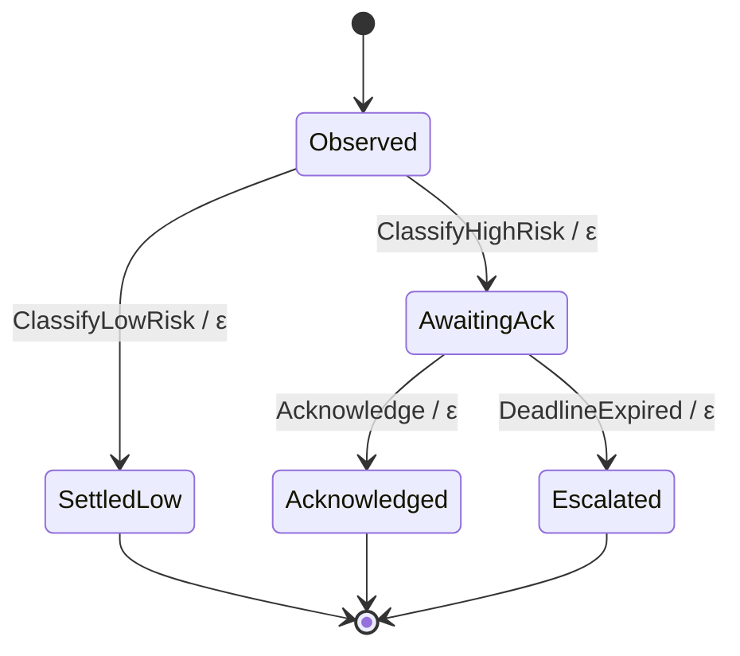

# Flows

A procedure of coding agents, declared tools and approvals is usually better written as a
[playbook](playbooks.md) in Dhall; write a Haskell flow for behavior a playbook cannot express.

`Flow` is the Haskell behavior DSL for agents whose work is a durable process, not a
single synchronous computation. It is an embedded DSL: flows are ordinary Haskell functions
using typed combinators, not a new Dhall syntax or a separate `.flow` language.

Dhall still declares the agent:

```dhall
behavior = Schema.Behavior.Flow { name = "at-risk-customer" }
```

The string names a compiled Haskell flow that the executable was composed with. A flow
ships in a *flow pack*, a library outside `shikigami-core`; see [Flow packs](#flow-packs).
The Dhall file owns identity, trigger shape, and any ordinary post-run sinks. The Haskell flow owns
control flow: journaled steps, waits, mid-run sink emissions, memory writes, and timeout or
acknowledgement branches.

## When to use Flow instead of Dhall

Stay with the simpler behavior arms when the agent can run once and return one JSON value:

| Need | Use |
| --- | --- |
| A cheap rule over structured fields | A registered `ShikumiProgram` |
| A typed pipeline or model-backed classifier | `ShikumiProgram` |
| Natural-language instructions and tools | `Skill` |

Use `Flow` when the behavior needs a lifecycle:

| Need | Why Flow |
| --- | --- |
| Wait for a human answer | Flow can park the keiro workflow and resume later. |
| Escalate after a deadline | Flow can combine an acknowledgement wait with a durable timeout. |
| Emit a sink before the run is complete | Flow can enqueue replay-safe sink intents mid-run. |
| Avoid repeating work after a crash | Flow journals named steps and replays recorded results. |
| Show or validate the lifecycle | Flow carries a keiki-rendered Mermaid state diagram. |
| Branch on a typed model result | The Decision capability pins admitted program/model state and replays validated results. |

Do not use Flow just to choose a recipient, tweak a prompt, or add a sink. Those are Dhall
declaration concerns. Flow is for behavior that has state over time.

## The DSL shape

A flow is an `effectful` Haskell function under `FlowEffects`:

```haskell
myFlow :: FlowEffects es => Value -> Eff es Value
myFlow payload = do
  activity <- currentActivity
  prior <- recall "history" (MemoryQuery "relevant prior memory")
  verdict <- step (StepName "classify") (pure (classify payload activity prior))
  if isLowRisk verdict
    then pure (toJSON verdict)
    else do
      _ <- emitSignal "alert" (alertFor verdict) (toJSON verdict)
      _ <- remember "alert-note" (toJSON ("alert emitted" :: Text))
      pure (toJSON verdict)
```

`FlowEffects` is the kernel's capability row. It includes `Workflow`, `Memory`, `Sink`,
`Activity`, `Acknowledgement`, `Delegate`, `Routing` and `Decision`. It exposes neither
`IOE` nor `Store`: external effects go through capability interpreters, which own their
journal and authorization boundaries. A named `step` in a flow body can checkpoint a pure
result.

Memory and sink calls take explicit stable labels. Their resulting journal names are
durable identifiers, and a pack owns the ones its flows journal: every label starts with
the pack's name, and the pack pins them in a golden file. Follow
[Workflow versioning](../workflow-versioning.md) before changing one.

## Flow packs

A flow pack is an ordinary Cabal library package that exports one `FlowPack` value. It
depends on two small public components of `shikigami-core` and on no other Shikigami
component:

| Component | Module | Who may import it |
| --- | --- | --- |
| `shikigami-core:flow-sdk` | `Shikigami.Flow.Sdk`, `Shikigami.Flow.Sdk.Program` | A flow body and the pack value |
| `shikigami-core:pack-sdk` | `Shikigami.Pack.Sdk` | A pack's interpreter only |

You never edit `shikigami-core` to add a flow. `just kernel-fitness` fails the build if a
use case is added there, and its message points back to this section.

The pack in this repository is `packs/flow-pack-examples`, which owns the
`at-risk-customer` flow. Its layout is the layout of every pack:

```text
packs/flow-pack-examples/
  flow-pack-examples.cabal
  bodies/FlowPack/Examples/Body/AtRiskCustomer.hs    the flow body
  src/FlowPack/Examples.hs                           examplesPack :: FlowPack
  src/FlowPack/Examples/Lifecycle/AtRiskCustomer.hs  the keiki lifecycle
  agents/at-risk-customer-flow.dhall                 the agent that names the flow
  test/Main.hs  test/golden/labels.txt               tests and the label inventory
```

Three rules shape it, and the fitness check enforces each:

- **Bodies are a separate sublibrary.** `library bodies` depends on
  `shikigami-core:flow-sdk` alone. GHC exposes only the modules of components a library
  depends on, so a body cannot import `IOE` or the store. Adding `import Effectful (IOE)`
  to a body fails the build with "member of the hidden package".
- **The pack library depends on the SDK only.** It may add `shikigami-core:pack-sdk`, which
  is where an interpreter finds `IOE`, `Store` and the run's read view. It holds no
  executable.
- **Packs and distributions are not named `shikigami-*`.** A pack is `flow-pack-<name>`
  with modules under `FlowPack.<Name>`.

### The pack value

A body that needs kernel capabilities alone is wrapped with `kernelCapabilityFlow`:

```haskell
module FlowPack.Examples (examplesPack) where

import FlowPack.Examples.Body.AtRiskCustomer (atRiskCustomerFlow, atRiskCustomerFlowName)
import Shikigami.Flow.Sdk

examplesPack :: FlowPack
examplesPack =
  FlowPack
    { name = either (error . show) id (parseFlowPackName "examples"),
      flows = [kernelCapabilityFlow atRiskCustomerDefinition atRiskCustomerFlow],
      decisionPrograms = [],
      retainedCodecs = [],
      tasks = []
    }

atRiskCustomerDefinition :: FlowDef
atRiskCustomerDefinition =
  FlowDef
    { name = atRiskCustomerFlowName,
      lifecycle = LifecycleDiagram {mermaid = atRiskCustomerMermaid, validationWarnings = []},
      decisionSlots = [],
      requiresDefaultModel = DefaultModelRequired,
      decisionMode = StrictDecisions
    }
```

Every `FlowDef` declares its decision slots, whether it needs the process's default model,
and its decision mode. `StrictDecisions` holds a declaration to every slot. An
`AdvisoryDecisions` flow treats a decision as an optional opinion: a slot whose models the
declaration does not list is left out, and a decision that cannot be made is reported to
the body instead of failing the run. See [Typed decisions in Flows](typed-decisions.md)
and the [registration guide](../shikumi-flow-decisions.md) for programs, retained codecs
and labels.

### A pack with a capability of its own

A flow that needs something the kernel does not provide defines its own capability. The
effect and its operations live in `bodies`, and the body is typed
`(FlowEffects es, Mine :> es) => Value -> Eff es Value`. The interpreter lives in the pack
library and is the only place the pack may perform IO:

```haskell
myFlow :: MyRuntime -> PackFlow
myFlow runtime =
  PackFlow
    { definition = myDefinition,
      run = \context payload -> runMine runtime context (myBody payload)
    }
```

`run` receives a `FlowRunContext`: the agent declaration, the resolved identity, the
session, the workflow name and run id, the triggering activity, and the directory. The
kernel installs its own interpreters around `run` and never names the pack's capability.
Journal every external effect of an interpreter under a `step` whose label starts with the
pack's name.

### Composing a pack into an executable

Stock executables compose the builtin pack and nothing else. A *distribution* is a package
of executables whose `main` passes packs to a role's entry point.
`packs/examples-distribution` is the whole of one:

```haskell
main :: IO ()
main = runRole (agentRunRoleInfoWith [examplesPack])   -- shikigami-examples-agent-run

main :: IO ()
main = runAdminWith [examplesPack]                      -- shikigami-examples
```

The entry points are `agentRunRoleInfoWith` (`Shikigami.Agent.Command`),
`workerRoleInfoWith` (`Shikigami.Workers.Command`) and `runAdminWith`
(`Shikigami.Server.Command`). Composition happens once at process start. Two packs with the
same name, flow name or task name refuse the start and name both owners, and a successful
start logs `flow.registry.composed` with each pack and its flows.

List what an executable was composed with, and run the flow:

```sh
cabal run shikigami-examples -- flows
cabal run shikigami-examples-agent-run -- \
  --agent packs/flow-pack-examples/agents/at-risk-customer-flow.dhall \
  --payload '{"text":"we are going to cancel our plan"}'
```

```text
builtin   watchdog-sweep     default-model=optional  slots=drift
examples  at-risk-customer   default-model=required  slots=-
{"event":"flow.selected","agent":"at-risk-customer","flow":"at-risk-customer","pack":"examples",...}
```

The stock `shikigami-agent-run` refuses the same manifest before it opens a session, and
names the flows it has:

```text
agent-run: unknown flow at-risk-customer; registered flows: run-declared-tool, watchdog-sweep, ...
```

`shikigami validate` and the worker's boot check make the same refusal, so a manifest
naming a flow of a pack the executable lacks never becomes a failed run per trigger.

### The label inventory

`just keiro-gate` checks the core workflow specification and cannot yet see a label a pack
journals. Each pack therefore ships `test/golden/labels.txt`, the sorted list of every
durable label its flows journal, and a test that derives the list by running each branch
of each flow and compares. For the examples pack:

```text
emit-signal-examples-alert
emit-signal-examples-escalate
examples-classify
flow-examples-await-ack
recall-examples-risk-history
remember-examples-acknowledged
remember-examples-declined
remember-examples-escalated
```

A label is either the pack's own (`examples-classify`) or a kernel capability prefix
followed by the pack's key (`recall-examples-risk-history`). Changing the file is a change
to a durable contract; treat it as [Workflow versioning](../workflow-versioning.md) treats
a step rename.

The matching Dhall manifest is small because the behavior body is compiled Haskell:

```dhall
let Schema = ../../../schema/Agent.dhall

in  Schema.Agent::{
    , name = "at-risk-customer"
    , trigger =
        Schema.Trigger.Stream
          { match =
              { verb = None Text
              , source = None Text
              , subjectType = Some "ticket"
              , verbs = [ "ticket.received" ]
              }
          }
    , behavior = Schema.Behavior.Flow { name = "at-risk-customer" }
    , sinks = [] : List Schema.Sink
    }
```

Use an empty `sinks` list when the flow emits all side effects at lifecycle points with
`emitSignal`. Keep ordinary sinks in Dhall when the final returned JSON should be dispatched
after the flow completes.

## Combinators

`currentActivity`

Returns the triggering `ActivityEnvelope`. Use this instead of reparsing the run job. The
worker supplies the original activity when available and synthesizes one for addressed runs.

`recall "label" (MemoryQuery text)`

Looks up prior kioku memories in the current agent scope. Use it before classification when
the flow should account for history.

`remember "label" value`

Records a kioku memory attached to the current flow session. Use it for durable notes such
as "acknowledged by X", "declined because Y", or "escalated after timeout".

`emitSignal "label" sink output`

Enqueues a sink intent into the transactional outbox from inside the workflow. This is for
mid-run effects such as "raise alert before waiting" or "send escalation after timeout".
It is permission-gated and replay-safe; it does not synchronously POST to the sink service.

`awaitAck stepName request`

The `Shikigami.Flow.Acknowledgement` capability parks the workflow until a human
approves, rejects, or the configured deadline fires. It returns:

```haskell
data Ack = Acknowledged Value | Declined Text | TimedOut
```

This is the point where Flow goes beyond Dhall: Dhall can name an agent, but it cannot
express "suspend this run for 15 minutes, resume on either a human answer or timer, then
choose a different branch."

## Lifecycle diagrams

Each flow carries a lifecycle diagram. Render it with an admin command composed with the
flow's pack:

```sh
cabal run shikigami-examples -- render-lifecycle packs/flow-pack-examples/agents/at-risk-customer-flow.dhall
```

The `at-risk-customer` diagram is:



The diagram is not just documentation. It is generated from the keiki transducer that the
test suite validates, so unreachable states, hidden inputs, and overlapping transitions can
be caught before the flow ships.

## Delivered Flow guides

These flows of the builtin pack have dedicated setup or operating guidance:

| Flow | Guide | Admission boundary |
| --- | --- | --- |
| `shikumi-decision-example` | [Typed decisions](typed-decisions.md) | Admitted model aliases and per-decision permissions |
| `adaptive-delivery` | [Finite adaptive delivery](adaptive-delivery.md) | Objective/assignment association, finite root and cutoff, permitted worker catalog |
| `propose-work` | [Unrequested work](unrequested-work.md) | Verified observer, bounded source allowance, human acceptance or standing policy |
| `watchdog-sweep` | [Watchdog notices](watchdog.md) | Scheduled verified principal, bounded observation scope and independent allowance |

The watchdog observes work and emits advisory findings. It cannot intervene in an
objective or grant a recurring mandate. The proposer may create an objective after
acceptance; autonomous funding and dispatch require a matching standing policy.

## At-risk customer

The teaching flow is `at-risk-customer`, owned by `packs/flow-pack-examples` and declared
at:

```sh
packs/flow-pack-examples/agents/at-risk-customer-flow.dhall
```

It classifies incoming ticket activity. Low-risk input returns a low-risk result and emits
no sink outbox message. High-risk input emits an alert, parks for acknowledgement, and then
either records the acknowledgement branch or escalates after the configured deadline.

Validate the manifest with:

```sh
cabal run shikigami-examples -- validate packs/flow-pack-examples/agents/at-risk-customer-flow.dhall
```

The stock `shikigami validate` refuses it, because the stock command composes no pack.
