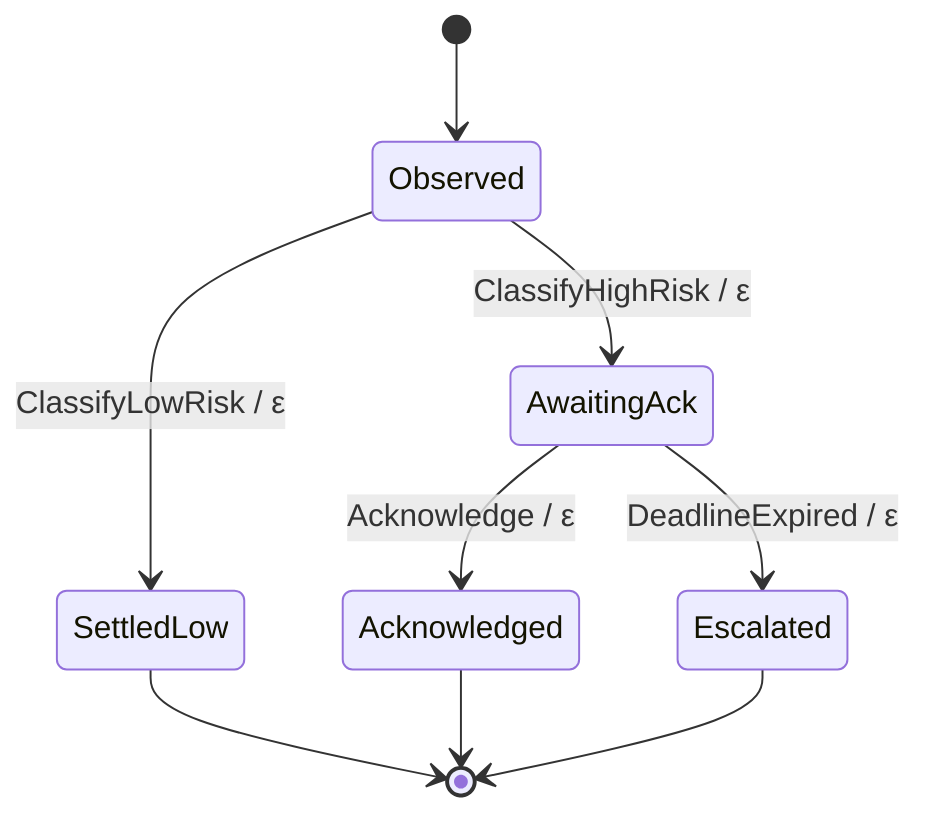

# Flows

`Flow` is the Haskell behavior DSL for agents whose work is a durable process, not a
single synchronous computation. It is an embedded DSL: flows are ordinary Haskell functions
using typed combinators, not a new Dhall syntax or a separate `.flow` language.

Dhall still declares the agent:

```dhall
behavior = Schema.Behavior.Flow { name = "at-risk-customer" }
```

The string names a compiled Haskell `FlowDef` in `Shikigami.Flow.flowRegistry`. The Dhall
file owns identity, trigger shape, and any ordinary post-run sinks. The Haskell flow owns
control flow: journaled steps, waits, mid-run sink emissions, memory writes, and timeout or
acknowledgement branches.

## When to use Flow instead of Dhall

Stay with the simpler behavior arms when the agent can run once and return one JSON value:

| Need | Use |
| --- | --- |
| A cheap rule over structured fields | `Deterministic` |
| A typed pipeline or model-backed classifier | `ShikumiProgram` |
| Natural-language instructions and tools | `Skill` |

Use `Flow` when the behavior needs a lifecycle:

| Need | Why Flow |
| --- | --- |
| Wait for a human answer | Flow can park the keiro workflow and resume later. |
| Escalate after a deadline | Flow can combine an acknowledgement wait with a durable timeout. |
| Emit a sink before the run is complete | Flow can enqueue replay-safe sink intents mid-run. |
| Avoid repeating work after a crash | Flow journals named steps and replays recorded results. |
| Show or validate the lifecycle | Flow carries a keiki-rendered Mermaid state diagram. |

Do not use Flow just to choose a recipient, tweak a prompt, or add a sink. Those are Dhall
declaration concerns. Flow is for behavior that has state over time.

## The DSL shape

A flow is an `effectful` Haskell function under `FlowEffects`:

```haskell
myFlow :: FlowEffects es => Value -> Eff es Value
myFlow payload = do
  activity <- currentActivity
  prior <- recall (MemoryQuery "relevant prior memory")
  verdict <- step (StepName "classify") (pure (classify payload activity prior))
  if isLowRisk verdict
    then pure (toJSON verdict)
    else do
      _ <- emitSignal (alertFor verdict) (toJSON verdict)
      _ <- remember (toJSON ("alert emitted" :: Text))
      pure (toJSON verdict)
```

`FlowEffects` includes keiro workflow effects plus shikigami domain effects:

```haskell
type FlowEffects es =
  ( Workflow :> es
  , Store :> es
  , IOE :> es
  , Memory :> es
  , Sink :> es
  , Activity :> es
  )
```

The important rule is that external side effects must go through the DSL capabilities or a
named keiro `step`. Completed steps are replayed from the journal after a restart, so
step names are part of the durable contract.

## Minimal Haskell example

To add a new flow, create a Haskell module under `shikigami-core/src/Shikigami/Flow/`,
expose it in `shikigami-core.cabal`, register it in `Shikigami.Flow.flowRegistry`, then
point a Dhall manifest at the registered name.

Example module:

```haskell
module Shikigami.Flow.OwnerReminder
  ( ownerReminderFlow,
  )
where

import Data.Aeson (Value (..), object, (.=))
import Data.Aeson.KeyMap qualified as KeyMap
import Data.Text (Text)
import Data.Text qualified as Text
import Effectful (Eff, IOE, (:>))
import Keiro.Workflow (StepName (..), Workflow, step)
import Kiroku.Store.Effect (Store)
import Shikigami.Api.Activity (ActivityEnvelope (..))
import Shikigami.Api.Agent qualified as Agent
import Shikigami.Flow.Capability
  ( Activity,
    Memory,
    MemoryQuery (..),
    currentActivity,
    emitSignal,
    recall,
    remember,
  )
import Shikigami.Flow.Capability qualified as Capability

ownerReminderFlow ::
  (Workflow :> es, Store :> es, IOE :> es, Memory :> es, Capability.Sink :> es, Activity :> es) =>
  Value ->
  Eff es Value
ownerReminderFlow payload = do
  activity <- currentActivity
  prior <- recall (MemoryQuery "recent owner reminder")
  missing <- step (StepName "check-owner") (pure (missingOwner payload))
  if not missing
    then
      pure
        ( object
            [ "status" .= ("ok" :: Text),
              "priorReminderCount" .= length prior
            ]
        )
    else do
      let output =
            object
              [ "status" .= ("reminder-sent" :: Text),
                "activityId" .= activityId activity
              ]
      _ <- emitSignal ownerReminderSignal output
      _ <- remember output
      pure output

missingOwner :: Value -> Bool
missingOwner = \case
  Object fields ->
    case KeyMap.lookup "owner" fields of
      Just (String owner) -> Text.null (Text.strip owner)
      _ -> True
  _ -> True

ownerReminderSignal :: Agent.Sink
ownerReminderSignal =
  Agent.KizashiSignal
    { Agent.source = "shinzui/shikigami",
      Agent.signalType = Agent.Reminder,
      Agent.priority = Agent.Normal,
      Agent.importance = 50,
      Agent.recipientFrom = Agent.AreaOwner,
      Agent.defaultRecipient = Just "role_area_owner",
      Agent.intentTemplate = "Assign an owner to the unowned item.",
      Agent.extraContextTags = ["flow:owner-reminder"]
    }
```

Then register it:

```haskell
import Shikigami.Flow.OwnerReminder (ownerReminderFlow)

flowRegistry :: FlowRuntime -> [FlowDef]
flowRegistry runtime =
  [ FlowDef
      { name = "at-risk-customer",
        lifecycle = atRiskCustomerLifecycleDiagram,
        run = atRiskCustomerFlow (approval runtime) (acknowledgementDeadline runtime)
      },
    FlowDef
      { name = "owner-reminder",
        lifecycle =
          LifecycleDiagram
            { mermaid =
                "stateDiagram-v2\n    [*] --> Observed\n    Observed --> Complete\n    Complete --> [*]\n",
              validationWarnings = []
            },
        run = ownerReminderFlow
      }
  ]
```

For production flows, prefer a real keiki lifecycle module like
`Shikigami.Flow.Lifecycle.AtRiskCustomer` instead of hand-written Mermaid text. The registry
only needs the `LifecycleDiagram`, but keiki gives validation as well as rendering.

The matching Dhall manifest is small because the behavior body is compiled Haskell:

```dhall
let Schema = ../../schema/Agent.dhall

in  Schema.Agent::{
    , name = "owner-reminder"
    , description = "Remind the area owner when an item has no owner."
    , trigger =
        Schema.Trigger.Stream
          { match =
              { verb = None Text
              , source = None Text
              , subjectType = Some "item"
              , verbs = [ "item.observed" ]
              }
          }
    , behavior = Schema.Behavior.Flow { name = "owner-reminder" }
    , sinks = [] : List Schema.Sink
    }
```

That is the intended split: Haskell expresses "check, journal, maybe emit, remember"; Dhall
expresses "this agent runs that compiled flow when this trigger matches."

## Combinators

`currentActivity`

Returns the triggering `ActivityEnvelope`. Use this instead of reparsing the run job. The
worker supplies the original activity when available and synthesizes one for addressed runs.

`recall (MemoryQuery text)`

Looks up prior kioku memories in the current agent scope. Use it before classification when
the flow should account for history.

`remember value`

Records a kioku memory attached to the current flow session. Use it for durable notes such
as "acknowledged by X", "declined because Y", or "escalated after timeout".

`emitSignal sink output`

Enqueues a sink intent into the transactional outbox from inside the workflow. This is for
mid-run effects such as "raise alert before waiting" or "send escalation after timeout".
It is permission-gated and replay-safe; it does not synchronously POST to the sink service.

`awaitAcknowledgement approval stepName request deadline`

Parks the workflow until a human approves, rejects, or the deadline fires. It returns:

```haskell
data Ack = Acknowledged Value | Declined Text | TimedOut
```

This is the point where Flow goes beyond Dhall: Dhall can name an agent, but it cannot
express "suspend this run for 15 minutes, resume on either a human answer or timer, then
choose a different branch."

## Registering a flow

Add the flow body and register it in `Shikigami.Flow.flowRegistry`:

```haskell
flowRegistry :: FlowRuntime -> [FlowDef]
flowRegistry runtime =
  [ FlowDef
      { name = "my-flow"
      , lifecycle = myLifecycleDiagram
      , run = myFlow (approval runtime) (acknowledgementDeadline runtime)
      }
  ]
```

`FlowRuntime` carries run-specific dependencies that cannot live in Dhall, such as the
current approval environment and acknowledgement deadline. The worker constructs it when it
routes a `Flow { name }` behavior through the durable agent workflow.

Then declare the agent in Dhall:

```dhall
let Schema = ../../schema/Agent.dhall

in  Schema.Agent::{
    , name = "my-flow-agent"
    , trigger = Schema.Trigger.Stream { match = ... }
    , behavior = Schema.Behavior.Flow { name = "my-flow" }
    , sinks = [] : List Schema.Sink
    }
```

Use an empty `sinks` list when the flow emits all side effects at lifecycle points with
`emitSignal`. Keep ordinary sinks in Dhall when the final returned JSON should be dispatched
after the flow completes.

## Lifecycle diagrams

Each registered flow can expose a keiki lifecycle diagram. Render it with:

```sh
cabal run shikigami -- render-lifecycle agents/detectors/at-risk-customer-flow.dhall
```

The `at-risk-customer` diagram is:



The diagram is not just documentation. It is generated from the keiki transducer that the
test suite validates, so unreachable states, hidden inputs, and overlapping transitions can
be caught before the flow ships.

## At-risk customer

The first registered flow is `at-risk-customer`, declared at:

```sh
agents/detectors/at-risk-customer-flow.dhall
```

It classifies incoming ticket activity. Low-risk input returns a low-risk result and emits
no sink outbox message. High-risk input emits an alert, parks for acknowledgement, and then
either records the acknowledgement branch or escalates after the configured deadline.

Validate the manifest with:

```sh
cabal run shikigami -- validate agents/detectors/at-risk-customer-flow.dhall
```
